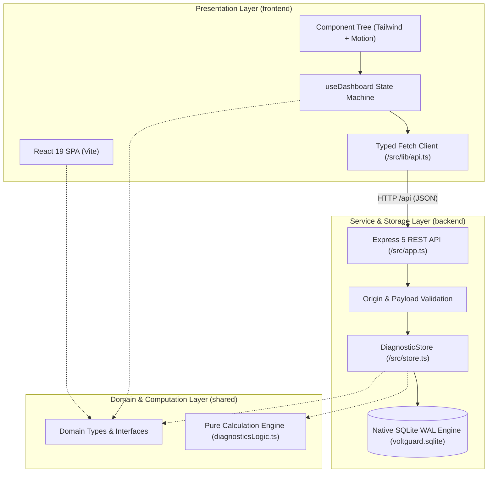
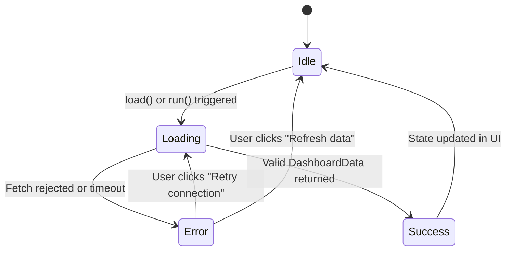

# Voltguard EV Diagnostic System — Architecture & System Design

This document details the architectural principles, data flow, mathematical modeling, and persistence strategy of the Voltguard EV Diagnostic System.

---

## 1. High-Level Architectural Pattern

Voltguard employs a **modular monorepo architecture** based on npm workspaces. The system strictly separates concerns into three distinct layers plus an integration test harness:



### Decoupling Rules
1. **Frontend never imports Backend source code or seed data**. All communication occurs exclusively over the HTTP REST API.
2. **Shared is completely framework-agnostic**. It contains pure TypeScript functions and interfaces with zero dependencies on React, Express, or SQLite.
3. **Deterministic testing at every boundary**:
   - `shared` logic is tested via isolated pure-function unit tests.
   - `backend` is tested via in-memory ephemeral SQLite instances and mock HTTP calls.
   - `frontend + backend` are tested together using a headless JSDOM browser environment executing against a live Express server.

---

## 2. Monorepo Package Breakdown

```text
Ai_carCheck_system/
├── shared/             @voltguard/shared
│   ├── src/
│   │   ├── diagnostics.ts         # TypeScript domain models and contracts
│   │   ├── diagnosticsLogic.ts    # Mathematical formulas and calendar algorithms
│   │   └── assets.ts              # Asset path constants
│   └── package.json
│
├── backend/            @voltguard/backend
│   ├── src/
│   │   ├── app.ts                 # Express routes, validation, and error handler
│   │   ├── store.ts               # SQLite persistence, seeding, and transactions
│   │   ├── index.ts               # Process entry point, config, and graceful shutdown
│   │   ├── errors.ts              # Custom HttpError class
│   │   └── data/seed.ts           # Initial baseline vehicle telemetry
│   ├── test/                      # Node.js native test runner suites
│   ├── data/                      # Local SQLite file (voltguard.sqlite)
│   └── package.json
│
├── frontend/           @voltguard/frontend
│   ├── src/
│   │   ├── App.tsx                # Master dashboard composition
│   │   ├── components/            # UI cards (Vehicle, Battery, Systems, Sidebar, TopNav)
│   │   ├── hooks/useDashboard.ts  # Central state machine and async data synchronization
│   │   ├── lib/api.ts             # Typed REST API client
│   │   └── data/vehicleVisuals.ts # 3D cutaway hotspots and angle metadata
│   ├── index.html                 # Browser entry point
│   ├── vite.config.ts             # Vite build & API proxy setup
│   └── package.json
│
└── tests/integration/  End-to-end UI + API integration tests
    └── App.test.tsx               # Headless DOM test exercising the complete stack
```

---

## 3. Data Model & Database Persistence

### 3.1. SQLite Storage Architecture
The backend leverages the Node.js 24 native synchronous SQLite driver (`node:sqlite.DatabaseSync`).

- **Write-Ahead Logging (WAL)**: Enabled via `PRAGMA journal_mode = WAL;`. This provides concurrent read operations without blocking write transactions.
- **Busy Timeout**: Configured to 5,000ms (`PRAGMA busy_timeout = 5000;`) to handle burst concurrency.
- **Table Definition**:
  ```sql
  CREATE TABLE IF NOT EXISTS vehicles (
    id TEXT PRIMARY KEY,
    data TEXT NOT NULL CHECK(json_valid(data))
  );
  ```
- **Integrity Constraint**: The `CHECK(json_valid(data))` constraint guarantees that malformed JSON payloads cannot be committed to disk.
- **Schema Versioning**: Monitored via `PRAGMA user_version`. Currently version `1`.

### 3.2. Atomic Mutations
All state modifications follow an ACID transaction pattern:

```typescript
private mutate(id: string, update: (vehicle: StoredVehicle) => void): DashboardData {
  this.db.exec('BEGIN IMMEDIATE');
  try {
    const vehicle = this.read(id);
    update(vehicle);
    this.db.prepare('UPDATE vehicles SET data = ? WHERE id = ?').run(JSON.stringify(vehicle), id);
    this.db.exec('COMMIT');
  } catch (error) {
    this.db.exec('ROLLBACK');
    throw error;
  }
  return this.dashboard(id);
}
```

---

## 4. EV Diagnostic Mathematical Modeling

The calculation engine in `shared/src/diagnosticsLogic.ts` provides deterministic, zero-side-effect computations simulating high-voltage battery physics:

### 4.1. Pack State of Charge (SOC) & Range Derating
When individual battery modules are toggled off (e.g., disconnected for service or due to cell degradation):

$$\text{ActiveRatio} = \frac{N_{\text{active}}}{N_{\text{total}}}$$

$$\text{EffectiveChargePercent} = \text{round}(\text{BaseChargePercent} \times \text{ActiveRatio})$$

$$\text{EstimatedRangeKm} = \text{round}(\text{BaseRangeKm} \times \text{ActiveRatio})$$

### 4.2. Traction Motor Derating
When battery pack power is restricted, the motor controller automatically derates peak output to prevent high current draw from remaining active modules:

$$\text{FrontDriveHealth} = \max(0, \text{BasePercentage} - (N_{\text{total}} - N_{\text{active}}) \times 4)$$

### 4.3. High-Voltage Bus & Thermal Metrics
The bus voltage and operating temperature reflect the arithmetic mean of all currently online modules:

$$V_{\text{bus}} = \frac{1}{N_{\text{active}}} \sum_{i \in \text{active}} V_i$$

$$T_{\text{pack}} = \frac{1}{N_{\text{active}}} \sum_{i \in \text{active}} T_i$$

---

## 5. Frontend State Machine & Concurrency Control

The frontend application uses a custom hook, `useDashboard`, to manage async state transitions:



### Concurrency Protection
1. **Single-flight Guard**: `if (pending.current) return;` prevents race conditions from overlapping button clicks.
2. **AbortController**: Every outgoing request creates a scoped `AbortController` linked with a 10-second timeout. If a component unmounts or a new request takes precedence, old requests are cancelled without throwing unhandled exceptions.
3. **Resilient Error State**: If a write fails (e.g. server offline), the user's view retains the last loaded data while rendering an informative alert rather than crashing.

---

## 6. Security & Hardening

1. **Origin Verification**: Requests with an `Origin` header must match configured `ALLOWED_ORIGINS` (default: `http://127.0.0.1:3000,http://localhost:3000`), rejecting unauthorized cross-site writes with `403 Forbidden`.
2. **Strict MIME Types**: Mutating methods (`POST`, `PATCH`, `DELETE`) require `Content-Type: application/json`. Non-JSON payloads are rejected with `415 Unsupported Media Type`.
3. **Body Size Limiting**: `express.json({ limit: '16kb' })` prevents memory exhaustion attacks; payloads exceeding 16kb are rejected with `413 Payload Too Large`.
4. **Header Hardening**: `X-Content-Type-Options: nosniff` and `Cache-Control: no-store` are applied to all `/api/*` endpoints.
5. **Input Sanitization**: Date parameters are validated with strict regular expressions (`/^20\d{2}-\d{2}-\d{2}$/`) and verified against `Date.parse` to disallow invalid calendar dates (e.g., February 30).
