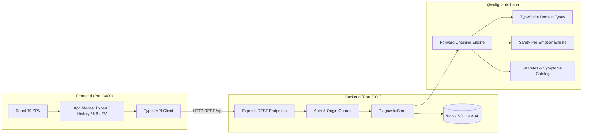

# Ai CarCheck & Voltguard: University-Level Automotive Expert System

[](https://nodejs.org/)
[](https://www.typescriptlang.org/)
[](https://react.dev/)
[](https://www.sqlite.org/)
[](docs/INFERENCE_ENGINE_ALGORITHM.md)
[](docs/RULE_TRACEABILITY_MATRIX.md)

**Ai CarCheck** is a deterministic, explainable, rule-based automotive expert system for vehicle fault diagnosis, paired with the **Voltguard** high-voltage EV telemetry simulation lab. Designed as a final-year university engineering project, the diagnostic engine operates **100% locally without third-party AI APIs**, utilizing pure forward-chaining inference over a verified knowledge base of **exactly 50 diagnostic rules**.

---

## What Does This Project Do?

1. **Vehicle Registration & Compatibility Filtering**: Supports gasoline, diesel, hybrid, and battery-electric vehicles across automatic, manual, CVT, and direct-drive transmissions. Incompatible rules are automatically filtered out.
2. **Deterministic Forward Chaining**: Evaluates user-selected symptoms and physical measurements against IF–THEN rules with tri-state logic (True, False, Unknown) and cycle prevention.
3. **Interactive Follow-Up Questioning**: Selects the most informative follow-up questions to differentiate competing hypotheses without repeating answered queries.
4. **Transparent Evidence Explanations**: Details which confirmed facts support each hypothesis, which facts contradict competing faults, and what missing checks remain.
5. **Urgent Safety Overrides**: Detects critical hazards (e.g. hydraulic brake failure, traction-battery thermal runaway, zero oil pressure) and executes safety guidance before ordinary fault ranking.
6. **Knowledge Base Administration**: Authorized administrators can manage, edit, activate/retire rules, and record formal peer reviews with credentials.
7. **Voltguard EV Telemetry Lab**: Fully preserves interactive high-voltage EV pack rebalancing, dynamic range derating, 3D-style cutaway inspection, and workshop scheduling.

---

## 50 Diagnostic Rules Catalog

The knowledge base implements exactly 50 uniquely identified rules grouped into eight categories:

| Category | Rule IDs | Domain Focus |
| :--- | :--- | :--- |
| **A. Starting & Electrical** | `EL01` – `EL08` (8) | 12V battery sulfation, parasitic draw, alternator charging, starter circuits, grounds |
| **B. Gasoline Engine** | `EN01` – `EN10` (10) | Ignition misfires, fuel delivery, vacuum leaks, MAF sensors, O2 heaters, catalytic converter, throttle control, CKP, EVAP, compression |
| **C. Cooling & Lubrication** | `TH01` – `TH07` (7) | Coolant leaks, fan relays, thermostats, water pumps, critical oil pressure, A/C circuits |
| **D. Braking Systems** | `BR01` – `BR05` (5) | Master cylinder bypass, vacuum booster assist, ABS wheel sensors, worn pad friction, seized calipers |
| **E. Steering & Suspension** | `CH01` – `CH06` (6) | Under-inflated tires (TPMS), alignment scrub, wheel balance, ball joints, EPS assist, hub bearings |
| **F. Transmission & Drivetrain**| `DR01` – `DR05` (5) | Automatic clutch slip, manual clutch slip, shift solenoids, CV joints, U-joint driveline lash |
| **G. Diesel Engine Systems** | `DS01` – `DS03` (3) | Glow plug preheating, common rail fuel pressure deficit, DPF soot loading |
| **H. Electric & Hybrid Vehicles**| `EV01` – `EV06` (6) | OBC charging faults, 12V aux battery inhibiting READY mode, HV isolation loss, thermal runaway hazard, inverter IGBTs, hybrid cooling fans |

See [docs/RULE_TRACEABILITY_MATRIX.md](docs/RULE_TRACEABILITY_MATRIX.md) for full citations and test cases.

---

## System Architecture



---

## Folder Structure

```text
Ai_carCheck_system/
├── frontend/                # React 19 website & UI components
│   ├── src/
│   │   ├── components/      # ExpertDiagnosisView, KnowledgeBaseView, HistoryView, EV cards
│   │   ├── hooks/           # useDashboard hook
│   │   ├── lib/api.ts       # Typed HTTP client for all expert and EV endpoints
│   │   └── App.tsx          # Master application shell with tab switcher
│   └── package.json
│
├── backend/                 # Node.js 24 + Express REST API
│   ├── src/
│   │   ├── store.ts         # SQLite WAL persistence, rule reviews, sessions, seeding
│   │   ├── app.ts           # REST routes, validation, admin authorization
│   │   └── index.ts         # Server startup & graceful shutdown
│   ├── test/
│   │   ├── expertRules.test.ts # 100+ rule scenario tests (positive + negative)
│   │   ├── expertApi.test.ts   # REST API & admin auth tests
│   │   └── app.test.ts         # Persistence, transactions, and security tests
│   └── package.json
│
├── shared/                  # Framework-independent domain package
│   ├── src/
│   │   ├── expert/          # Forward-chaining engine, safety engine, 50 rules catalog
│   │   ├── diagnostics.ts   # Telemetry interfaces
│   │   └── diagnosticsLogic.ts # Pack summary & calendar logic
│   └── package.json
│
├── tests/integration/       # Full-stack headless DOM integration tests
│   ├── App.test.tsx         # EV telemetry integration test
│   └── ExpertDiagnosis.test.tsx # Expert diagnosis user journey test
│
├── docs/                    # University Project Documentation
│   ├── SRS.md               # Software Requirements Specification
│   ├── SYSTEM_ARCHITECTURE.md # Architecture, ERD, Use-Case, DFD diagrams
│   ├── INFERENCE_ENGINE_ALGORITHM.md # Formal forward-chaining algorithm & pseudocode
│   ├── RULE_TRACEABILITY_MATRIX.md   # 50-rule matrix (Source -> Code -> Tests -> Status)
│   └── TESTING_STRATEGY_AND_RESULTS.md # Empirical test report (20 test suites, 100% pass)
│
├── README.md                # Project documentation
├── ARCHITECTURE.md          # Technical design specification
└── package.json             # Root workspace definitions & unified scripts
```

---

## Quick Start

### Prerequisites
- **Node.js 24 or newer** (`node -v`)
- npm

### 1. Install Dependencies
```sh
npm ci
```

### 2. Start Everything in Development Mode
```sh
npm run dev
```

- **Frontend Application**: [http://127.0.0.1:3000](http://127.0.0.1:3000)
- **Backend API Health**: [http://127.0.0.1:3001/api/health](http://127.0.0.1:3001/api/health)
- **Database**: `backend/data/voltguard.sqlite` (automatically created & seeded)

---

## Verification & Testing

To run the complete verification suite:

```sh
npm run check
```

This command executes:
1. **Strict TypeScript checks** across all workspaces.
2. **18 Backend test suites** (`npm test --workspace backend`), including:
   - Positive and negative evaluation scenarios for **all 50 rules** (over 100 test scenarios).
   - Incompatible vehicle isolation (ICE vs EV, Manual vs Automatic, Diesel vs Gasoline).
   - Safety engine overrides and critical flags.
   - Deterministic inference reproducibility.
   - REST API endpoints and administrative authorization.
   - Database WAL persistence across connection reopens.
3. **2 Full-stack integration tests** (`npm run test:integration`) in JSDOM.
4. **Full production builds** for `shared`, `frontend`, and `backend`.

---

## REST API Reference

All requests and responses use JSON.

### Expert System Endpoints
| Method | Endpoint | Description |
| :--- | :--- | :--- |
| `GET` | `/api/expert-vehicles` | Returns registered vehicle profiles |
| `POST` | `/api/expert-vehicles` | Registers a new vehicle profile |
| `GET` | `/api/symptoms` | Lists diagnostic symptoms (`?category=...`) |
| `GET` | `/api/diagnostic-rules` | Lists 50 rules (`?category=...&status=...`) |
| `GET` | `/api/diagnostic-rules/:id`| Returns single rule specification |
| `POST` | `/api/diagnoses` | Starts session with vehicle and symptom codes |
| `GET` | `/api/diagnoses/:id` | Gets session state and working memory |
| `POST` | `/api/diagnoses/:id/answers`| Submits answer to follow-up question |
| `GET` | `/api/diagnoses/:id/results`| Evaluates forward chaining and returns results |
| `GET` | `/api/diagnoses/history` | Lists past diagnostic sessions |

### Admin Endpoints (Requires `x-admin-key: carcheck-admin-2026`)
| Method | Endpoint | Description |
| :--- | :--- | :--- |
| `POST` | `/api/admin/rules` | Proposes a new rule |
| `PATCH`| `/api/admin/rules/:id` | Updates an existing rule or toggles enabled state |
| `POST` | `/api/admin/rules/:id/reviews`| Records peer review with reviewer credentials and status |

### Voltguard EV Dashboard Endpoints
| Method | Endpoint | Description |
| :--- | :--- | :--- |
| `GET` | `/api/health` | Service and SQLite health status |
| `GET` | `/api/vehicles` | Voltguard test vehicle profiles |
| `GET` | `/api/vehicles/:id/dashboard` | Vehicle state and computed pack summary |
| `PATCH`| `/api/vehicles/:id/modules/:id` | Toggles battery module enabled/disabled |
| `POST` | `/api/vehicles/:id/scans` | Runs sample battery scan snapshot |
| `POST` | `/api/vehicles/:id/service-events`| Schedules service event |
| `DELETE`| `/api/vehicles/:id/service-events/:id`| Cancels scheduled service event |

---

## Academic & Technical Documentation

- **[Software Requirements Specification (SRS)](docs/SRS.md)**
- **[System Architecture & Diagrams (ERD, Use-Case, DFD)](docs/SYSTEM_ARCHITECTURE.md)**
- **[Inference Engine Algorithm & Pseudocode](docs/INFERENCE_ENGINE_ALGORITHM.md)**
- **[Rule Traceability Matrix (All 50 Rules)](docs/RULE_TRACEABILITY_MATRIX.md)**
- **[Testing Strategy & Empirical Results](docs/TESTING_STRATEGY_AND_RESULTS.md)**
- **[System Architecture Details](ARCHITECTURE.md)**
