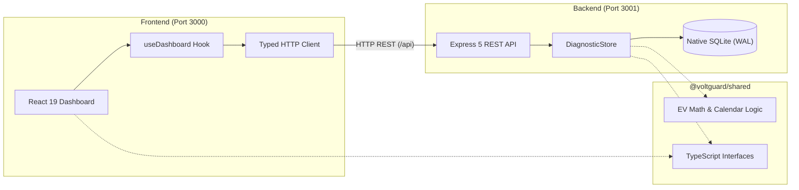

# Voltguard EV Diagnostic System

[](https://nodejs.org/)
[](https://www.typescriptlang.org/)
[](https://react.dev/)
[](https://www.sqlite.org/)
[](https://tailwindcss.com/)

An interactive **Electric Vehicle (EV) Diagnostic & Telemetry System** built as an engineering console for workshop technicians. The system provides real-time monitoring of high-voltage battery modules, electric powertrains, and thermal cooling circuits, featuring dynamic pack rebalancing, appointment scheduling, and persistent SQLite storage.

---

## What Does This Project Do?

Voltguard simulates a high-voltage EV diagnostic workstation (such as for a *Lead HV Diagnostics Engineer* in a service bay). It enables technicians to:

1. **Monitor High-Voltage Telemetry**: Inspect individual battery modules (voltage, cell delta $\text{mV}$, operating temperature, state of health $\text{SOH}$) and powertrain components.
2. **Simulate Battery Module Isolation**: Switch off degraded modules and watch the system dynamically recalculate the vehicle's effective State of Charge ($\text{SOC}$), driving range, bus voltage, and motor health.
3. **Explore Interactive Vehicle Systems**: Rotate the vehicle through multiple 3D-style angles (3/4 Cutaway, Chassis Zoom, Flipped Profile) and inspect focal hotspots.
4. **Schedule Workshop Services**: Book diagnostic inspections into specific time slots on an interactive 7-day calendar, complete with double-booking prevention.
5. **Switch Between Vehicles**: Toggle between Workshop Bay 03, Workshop Bay 01, and Dyno Cell 02—each maintaining isolated persistent diagnostic telemetry.
6. **Run Diagnostic Scans**: Trigger full-vehicle scans that record immutable timestamped reports and update the technician's notification feed.

---

## System Architecture

Voltguard is structured as an **npm workspaces monorepo** where the frontend and backend are completely decoupled and share only pure contracts and business logic via `@voltguard/shared`:



For detailed system design, concurrency model, and data schemas, see [ARCHITECTURE.md](ARCHITECTURE.md).

---

## Folder Structure

```text
Ai_carCheck_system/
├── frontend/                # React 19 website & UI components
│   ├── src/                 # Components, hooks, custom SVG gauges, and styles
│   ├── public/              # Static web assets
│   ├── vite.config.ts       # Vite configuration with API reverse proxy
│   └── package.json         # Frontend dependencies and scripts
│
├── backend/                 # Node.js 24 + Express REST API
│   ├── src/                 # Express app, SQLite store, and database seeding
│   ├── test/                # API and calculation test suites
│   ├── data/                # Local SQLite database (voltguard.sqlite)
│   └── package.json         # Backend dependencies and scripts
│
├── shared/                  # Framework-independent domain package
│   ├── src/                 # Shared types, telemetry contracts, and math formulas
│   └── package.json         # Package exports (@voltguard/shared)
│
├── tests/integration/       # Full-stack integration tests
│   └── App.test.tsx         # Headless browser + live API test suite
│
├── ARCHITECTURE.md          # In-depth architectural documentation
├── package.json             # Root workspace definitions & unified scripts
└── package-lock.json        # Reproducible dependency lockfile
```

---

## Quick Start

### Prerequisites
- **Node.js 24 or newer** (verify with `node -v`)
- npm (bundled with Node.js)

### 1. Install Dependencies
```sh
npm ci
```

### 2. Start the Development Server
```sh
npm run dev
```

This single command:
1. Builds `@voltguard/shared` and watches for TypeScript changes.
2. Starts the **Backend API** at [http://127.0.0.1:3001](http://127.0.0.1:3001/api/health).
3. Starts the **Frontend Web App** at [http://127.0.0.1:3000](http://127.0.0.1:3000).

> [!NOTE]
> No database installation, Docker, cloud account, or API keys are required. The SQLite database is automatically created and seeded in `backend/data/voltguard.sqlite` on first startup.

---

## Available Commands

| Command | Purpose |
| :--- | :--- |
| `npm run dev` | Runs shared watcher, backend API, and frontend Vite server together |
| `npm run dev:frontend` | Runs only the frontend development server |
| `npm run dev:backend` | Runs only the backend development server |
| `npm run check` | **Full verification**: runs TypeScript linting, all tests, and production builds |
| `npm test` | Runs unit tests, database persistence tests, and integration tests |
| `npm run test:integration` | Runs headless browser-to-API integration tests |
| `npm run build` | Compiles `@voltguard/shared`, frontend, and backend for production |
| `npm start` | Serves the production build (frontend + API) on [http://127.0.0.1:3001](http://127.0.0.1:3001) |
| `npm run clean` | Deletes build output (`dist/`), safely keeping the SQLite database |

---

## Configuration

Both frontend and backend work out-of-the-box with zero configuration. To customize ports or paths, copy the example environment files:

```sh
cp frontend/.env.example frontend/.env
cp backend/.env.example backend/.env
```

| Workspace | Variable | Default | Description |
| :--- | :--- | :--- | :--- |
| **Backend** | `PORT` | `3001` | API listen port |
| **Backend** | `HOST` | `127.0.0.1` | Network bind address |
| **Backend** | `DATABASE_PATH` | `./data/voltguard.sqlite` | SQLite database file location |
| **Backend** | `ALLOWED_ORIGINS` | `http://127.0.0.1:3000,http://localhost:3000` | Permitted browser origins |
| **Frontend**| `API_PROXY_TARGET` | `http://127.0.0.1:3001` | Target backend URL for Vite proxy |

---

## REST API Reference

All requests and responses use JSON. Mutating operations (`POST`, `PATCH`, `DELETE`) require `Content-Type: application/json`.

| Method | Endpoint | Description |
| :--- | :--- | :--- |
| `GET` | `/api/health` | Service and SQLite health status |
| `GET` | `/api/vehicles` | Returns array of vehicle profiles (`bay-03`, `bay-01`, `dyno-02`) |
| `GET` | `/api/vehicles/:id/dashboard` | Returns full vehicle state and computed pack summaries |
| `PATCH` | `/api/vehicles/:id/modules/:moduleId` | Enables or disables a battery module (`{"enabled": false}`) |
| `POST` | `/api/vehicles/:id/scans` | Executes a diagnostic scan and records an immutable report |
| `POST` | `/api/vehicles/:id/notifications/read-all` | Marks all vehicle notifications as read |
| `POST` | `/api/vehicles/:id/service-events` | Schedules a service slot (`{"date": "2026-12-01", "timeSlot": "09:00"}`) |
| `DELETE`| `/api/vehicles/:id/service-events/:eventId` | Cancels a booked service event |

---

## Understanding EV Telemetry Metrics

Voltguard models realistic electric vehicle engineering parameters:

- **State of Health (SOH %)**: Reflects total battery degradation compared to factory capacity. Voltguard displays module SOH (e.g. 98%, 97%).
- **Cell Delta ($\Delta\text{mV}$)**: The voltage difference between the strongest and weakest parallel cell groups. A low delta ($2\text{--}5\text{ mV}$) indicates excellent balance; elevated deltas indicate defective cells or thermal unevenness.
- **Dynamic Derating**: Disabling a module recalculates effective charge and range:
  $$\text{EffectiveCharge} = \text{round}\left(\text{BaseCharge} \times \frac{\text{ActiveModules}}{\text{TotalModules}}\right)$$
  Disabling modules also automatically derates the front-drive motor health to simulate inverter thermal and current limiting.
- **Cooling Circuit**: Tracks dual-loop coolant flow ($12.4\text{ L/min}$) and pump speed ($2,400\text{ RPM}$) via a custom centrifugal impeller SVG gauge.

---

## Verification & Testing

To run the complete verification suite:

```sh
npm run check
```

This verifies:
1. **Strict TypeScript checks** across `shared`, `backend`, `frontend`, and `tests`.
2. **Pure calculation engine tests** (`diagnosticsLogic.test.ts`).
3. **Database persistence and security tests** (`app.test.ts`), confirming:
   - Data persists across database file close/reopen.
   - Separate vehicle bays remain strictly isolated.
   - Cross-origin writes (`403`), duplicate bookings (`409`), bad dates (`400`), and oversized bodies (`413`) are cleanly rejected.
4. **End-to-end integration tests** (`App.test.tsx`), rendering the real React UI against a real Express server in JSDOM and validating user interactions, offline recovery, and dynamic telemetry updates.
5. **Full production builds** for all three workspaces.

---

## Documentation

- **[System Architecture (ARCHITECTURE.md)](ARCHITECTURE.md)**: Deep dive into design decisions, state machines, and data structures.
- **[Frontend Guide (frontend/README.md)](frontend/README.md)**: UI components, styling, and client configuration.
- **[Backend Guide (backend/README.md)](backend/README.md)**: API routes, SQLite storage, transactions, and deployment.
