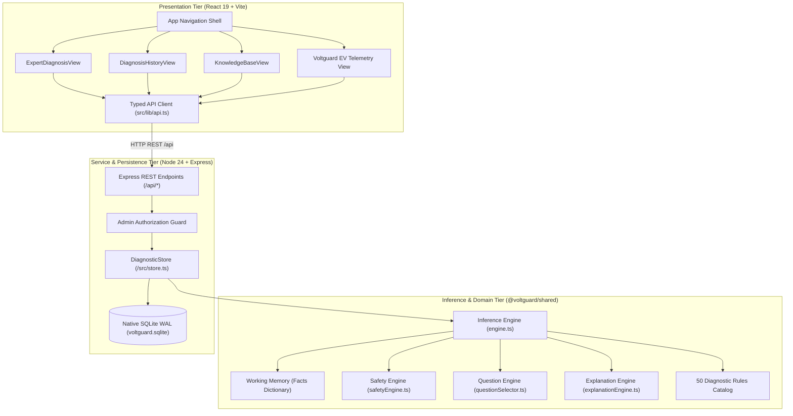
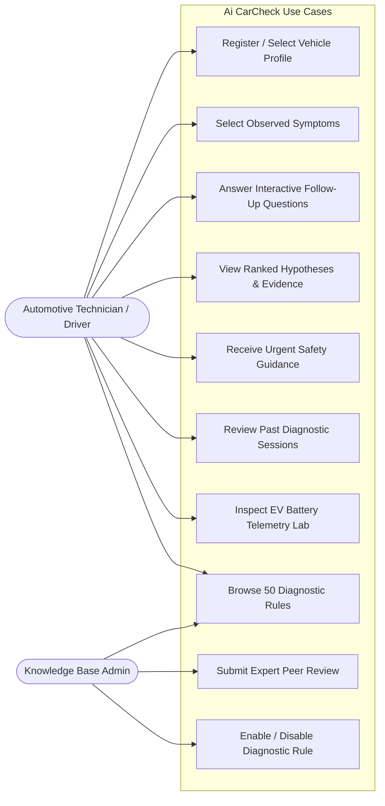
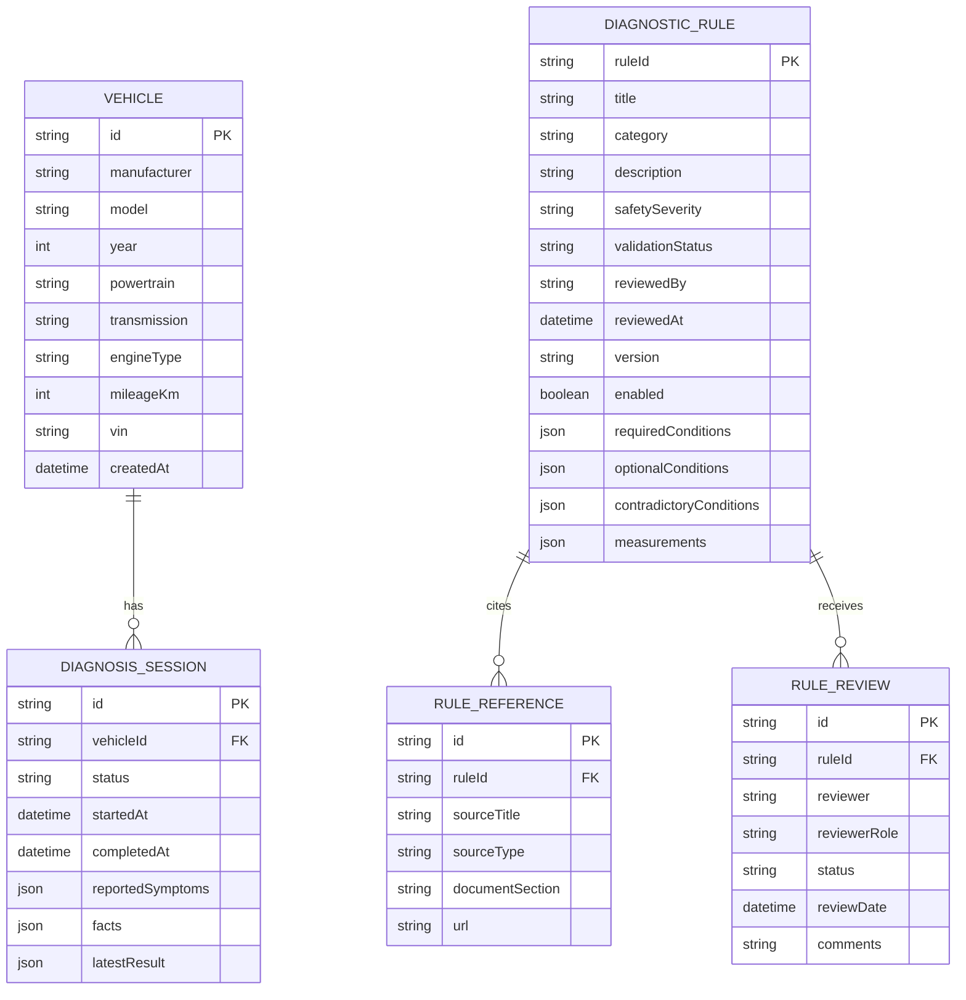
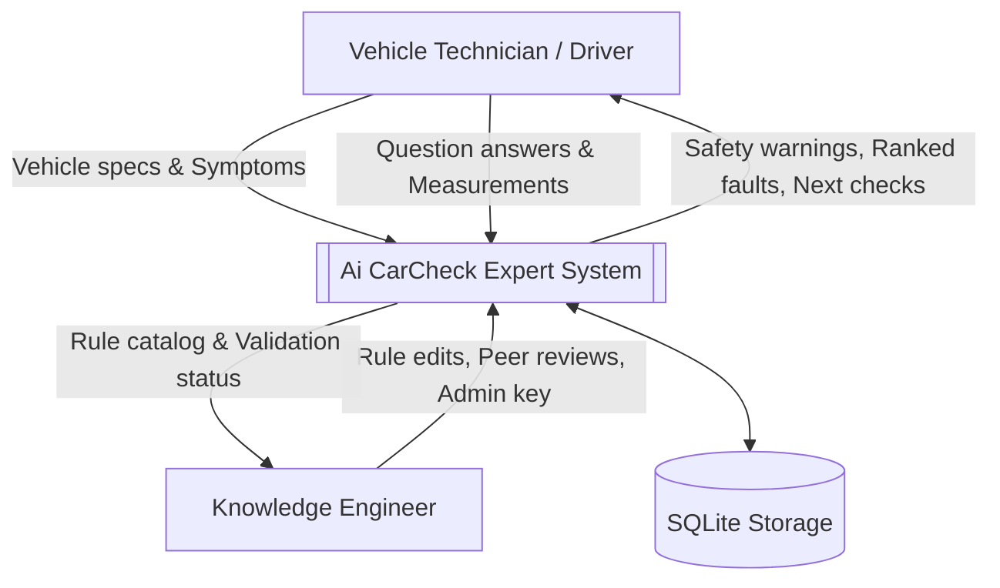
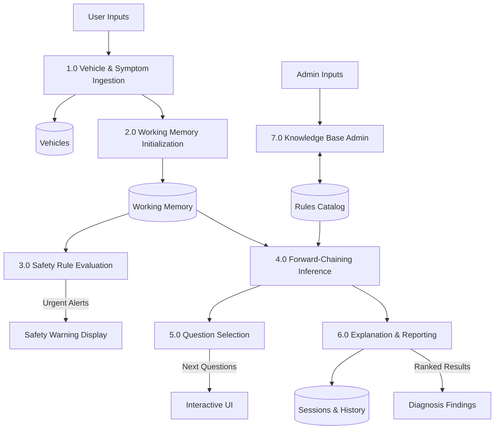

# System Architecture & Design Specification
## Ai CarCheck Automotive Expert System

---

## 1. High-Level Architectural Pattern

The application is structured as a **three-tier monorepo architecture** utilizing npm workspaces, ensuring absolute separation of concerns between client presentation, rule-based inference, and transactional storage.

---

## 2. Use-Case Diagram

---

## 3. Entity Relationship Diagram (ERD)

---

## 4. Data Flow Diagram (DFD)

### Level 0: Context Diagram

### Level 1: Subsystem Data Flow

