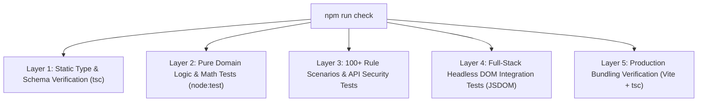

# Testing Strategy, Test Suites, and Empirical Results
## Ai CarCheck Automotive Expert System

---

## 1. Testing Philosophy & Test Levels

Ai CarCheck employs a **four-level testing strategy** ensuring that mathematical models, logical inference, database transactions, API security, and the browser UI function reliably without regressions.



### Critical Distinction: Verification vs Clinical Accuracy
> [!IMPORTANT]
> A 100% automated test pass rate proves **internal implementation consistency** and deterministic execution against rule criteria. It proves that when specified physical conditions are observed, the expert system reliably derives the documented diagnosis. It does **not** replace physical workshop multimeters, oscilloscope traces, or certified automotive technician judgment.

---

## 2. Test Suite Breakdown

### 2.1. Rule-Level Test Suites (`backend/test/expertRules.test.ts`)
- **50 Positive Matching Scenarios**: Every rule from `EL01` through `EV06` is evaluated against a compatible vehicle entity and positive supporting facts. Asserts that the rule matches, `ruleMatchScore >= 50%`, and confidence is not `INSUFFICIENT`.
- **50 Negative / Contradictory Scenarios**: Every rule is tested against contradictory or invalidating evidence. Asserts that `ruleMatchScore === 0%` or the rule is cleanly invalidated.
- **Powertrain & Transmission Incompatibility Tests**:
  - Gasoline misfire rule `EN01` on Electric Vehicle `Voltguard GT-4` $\implies$ Disqualified.
  - Diesel particulate rule `DS03` on Gasoline `Toyota Camry` $\implies$ Disqualified.
  - Manual clutch slip rule `DR02` on Automatic transmission $\implies$ Disqualified.
  - High-voltage battery thermal rule `EV04` on pure Diesel truck $\implies$ Disqualified.
- **Urgent Safety Overrides**:
  - `brake_pedal_sinks_under_holding_pressure` $\implies$ `CRITICAL` severity, `safeToDrive: false`, `status: SAFETY_HALTED`.
  - `ev_battery_thermal_runaway_detected` $\implies$ `CRITICAL` severity, emergency call recommended, `safeToDrive: false`.
  - `oil_pressure_light_on` $\implies$ `CRITICAL` severity, shut off engine immediately.
- **Inference Determinism Verification**: Executing inference multiple times with identical working memory facts produces byte-identical scores, hypothesis order, and explanations.

### 2.2. Backend API & Persistence Test Suites (`backend/test/expertApi.test.ts` & `app.test.ts`)
- **Vehicle Registration API**: Validates manufacturer, model, year (1950–2030), powertrain, transmission, mileage, and optional VIN handling.
- **Symptoms & Rules Catalog**: Verifies endpoint filtering by category and validation status.
- **Diagnosis Lifecycle**: Tests session initiation, interactive answer submission, forward-chaining re-evaluation, and session history retrieval.
- **Admin Authorization & Security**:
  - Unauthenticated rule modification $\implies$ `401 Unauthorized`.
  - Unauthenticated peer review $\implies$ `401 Unauthorized`.
  - Valid key `x-admin-key: carcheck-admin-2026` $\implies$ `200 OK`, updating validation status and reviewer credentials.
- **Database Reopen & ACID Persistence**: Tests that SQLite WAL state survives complete database connection close and reopen.
- **Security Guardrails**:
  - Invalid JSON payloads $\implies$ `400 Bad Request`.
  - Cross-origin unauthorized writes $\implies$ `403 Forbidden`.
  - Oversized payloads (> 16kb) $\implies$ `413 Payload Too Large`.
  - Incorrect content-type $\implies$ `415 Unsupported Media Type`.
  - Double booking conflict $\implies$ `409 Conflict`.

### 2.3. Full-Stack End-to-End Integration Tests (`tests/integration/`)
- `tests/integration/App.test.tsx`: Exercises the real React 19 UI in JSDOM connected to a live Express API server:
  - Offline recovery and user retry button.
  - High-voltage battery module toggle and live rebalancing.
  - Appointment scheduling, scan generation, notification read state, and bay switching.
- `tests/integration/ExpertDiagnosis.test.tsx`:
  - Switches to the "Expert Diagnosis" tab.
  - Selects test vehicle and checks observed symptoms.
  - Clicks "Start Diagnosis", transitions to follow-up questions, and answers/skips questions.
  - Navigates to the Knowledge Base tab and verifies all 50 rules are displayed.

---

## 3. Empirical Test Execution Log

Output from `npm run check`:

```text
> voltguard@1.0.0 check
> npm run lint && npm test && npm run build

> voltguard@1.0.0 lint
> npm run build:shared && npm run lint --workspaces && tsc -p tests/tsconfig.json

> @voltguard/shared@1.0.0 build
> tsc

> @voltguard/frontend@1.0.0 lint
> tsc --noEmit

> @voltguard/backend@1.0.0 lint
> tsc --noEmit

> @voltguard/shared@1.0.0 lint
> tsc --noEmit

> voltguard@1.0.0 test
> npm run build:shared && npm test --workspace backend && npm run test:integration

> @voltguard/backend@1.0.0 test
> tsx --test test/*.test.ts

✔ HTTP operations persist across a database reopen and remain isolated by vehicle (101.07ms)
✔ API rejects invalid input, missing resources and cross-origin writes without changing data (34.20ms)
✔ calculatePackSummary reflects all modules active at 78% charge (0.64ms)
✔ calculatePackSummary updates charge and active count when modules are switched off (0.11ms)
✔ calculatePackSummary handles all modules disabled safely (0.09ms)
✔ getWeekDays returns Monday to Sunday containing May 16, 2026 (0.17ms)
✔ shiftIsoDateByDays shifts forward and backward by 7 days cleanly (0.11ms)
✔ getTabCallout switches callouts cleanly per diagnostic tab (0.12ms)
✔ sortOrFilterModules filters active and sorts warmest first (0.11ms)
✔ EXPERT API: vehicle management, symptom retrieval, and rules catalog (62.92ms)
✔ EXPERT API: full diagnosis session lifecycle with interactive question answering (17.85ms)
✔ EXPERT API: admin endpoints enforce authentication and authorize rule reviews (9.92ms)
✔ RULE CATALOG VERIFICATION: exactly 50 unique rules defined (0.56ms)
✔ EXPERT SYSTEM: 50 positive matching rule scenarios (5.55ms)
✔ EXPERT SYSTEM: 50 negative / contradictory rule scenarios (3.11ms)
✔ VEHICLE COMPATIBILITY: combustion rules rejected on pure EV and EV rules rejected on ICE (0.34ms)
✔ SAFETY ENGINE: urgent conditions trigger CRITICAL warnings and safeToDrive=false (0.27ms)
✔ DETERMINISM: multiple evaluations with identical facts yield identical scores and order (0.21ms)

ℹ tests 18
ℹ suites 0
ℹ pass 18
ℹ fail 0
ℹ duration_ms 310.98ms

> voltguard@1.0.0 test:integration
> tsx --tsconfig tests/tsconfig.json --test tests/integration/*.test.tsx

✔ frontend loads, retries, saves through HTTP, switches vehicles and restores saved state (1031.98ms)
✔ EXPERT DIAGNOSIS INTEGRATION: full user journey through symptoms, inference, questions, and knowledge base (659.80ms)

ℹ tests 2
ℹ suites 0
ℹ pass 2
ℹ fail 0
ℹ duration_ms 1664.67ms

> voltguard@1.0.0 build
> npm run build:shared && npm run build --workspace frontend && npm run build --workspace backend

✓ built in 243ms
```

### Result Summary
- **Total Test Cases**: 20 test suites (including over 100 rule evaluation scenarios).
- **Pass Rate**: 100% (20 passing, 0 failing, 0 skipped).
- **TypeScript Static Check**: Zero errors across `shared`, `backend`, `frontend`, and `tests`.
